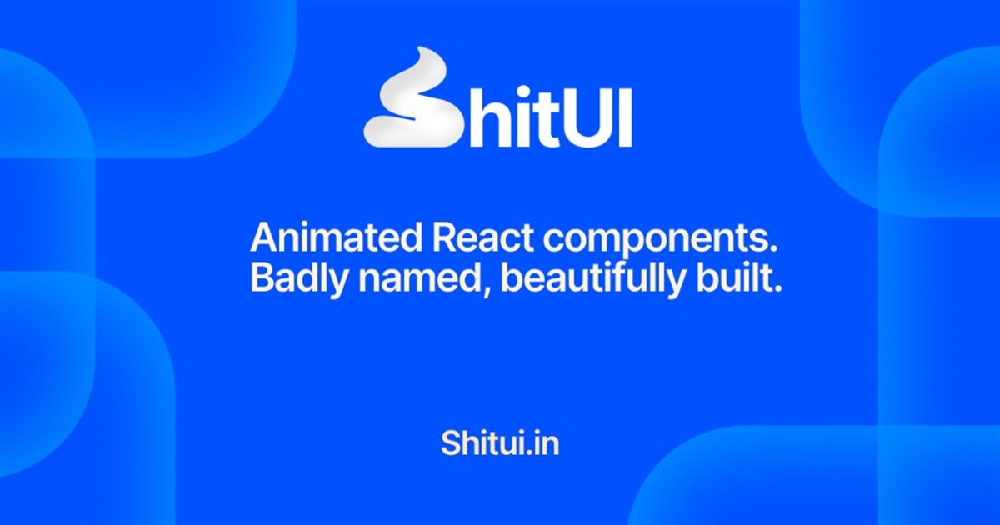

<div align="center">
  <a href="https://shitui.in">
    
  </a>
</div>

<div align="center">
  <br />
  <h3>Animated React components. Badly named, beautifully built.</h3>
  <p>Free, open-source animated UI component library built with Tailwind CSS, Next.js, and Motion.</p>

  <a href="https://shitui.in"><strong>Explore Components</strong></a>
  <br /><br />

  <a href="https://github.com/Codewithswappy/ShitUI/stargazers"></a>
  <a href="LICENSE.md"></a>
  <a href="https://x.com/heyyswap"></a>
  <a href="https://shitui.in"></a>
</div>

---

## Sponsors

Support continuous development and feature your product, tool, or brand directly in front of thousands of design engineers and developers.

<div align="center">
  <br />
  <a href="https://shitui.in/sponsors">
    
  </a>
  <br /><br />
</div>

### Max Sponsors

<p align="center">
  <a href="https://shitui.in/sponsors">
    
  </a>
  &nbsp;&nbsp;&nbsp;&nbsp;
  <a href="https://shitui.in/sponsors">
    
  </a>
</p>

### Core Sponsors

<p align="center">
  <a href="https://shitui.in/sponsors">
    
  </a>
  &nbsp;&nbsp;&nbsp;&nbsp;
  <a href="https://shitui.in/sponsors">
    
  </a>
  &nbsp;&nbsp;&nbsp;&nbsp;
  <a href="https://shitui.in/sponsors">
    
  </a>
</p>

### Lite Sponsors

<p align="center">
  <a href="https://shitui.in/sponsors">
    
  </a>
  &nbsp;&nbsp;&nbsp;&nbsp;
  <a href="https://shitui.in/sponsors">
    
  </a>
  &nbsp;&nbsp;&nbsp;&nbsp;
  <a href="https://shitui.in/sponsors">
    
  </a>
  &nbsp;&nbsp;&nbsp;&nbsp;
  <a href="https://shitui.in/sponsors">
    
  </a>
</p>

<br />

> **Custom Partnerships & Spot Reservations:**
> Reserve your spot directly at [**shitui.in/sponsors**](https://shitui.in/sponsors) or contact [@heyyswap](https://x.com/heyyswap) on X / email `useshit.ui@gmail.com`.

---

## Quick Start (shadcn CLI)

Install any component directly into your project with the official shadcn CLI:

```bash
npx shadcn@latest add @shitui/[component-name]
```

**Examples:**
```bash
npx shadcn@latest add @shitui/liquid-button
npx shadcn@latest add @shitui/liquid-tooltip
npx shadcn@latest add @shitui/book-3d
```

Visit **[shitui.in](https://shitui.in)** to preview components and copy code.

---

## Features

- **Fluid Motion**: Tactile spring physics, audio feedback, and micro-interactions powered by Motion (`motion/react`).
- **Zero-Lock Copy & Paste**: Full ownership of your code with shadcn CLI registry support.
- **Tailwind & TypeScript**: Built with Tailwind CSS and strictly typed with TypeScript.
- **Dark Mode Ready**: Automatic light and dark mode styling out of the box.
- **Free for Personal & Commercial Use**: Use components in apps, SaaS, and client projects.

---

## Contributing

Contributions, bug reports, and suggestions are welcome!
- Check [Open Issues](https://github.com/Codewithswappy/ShitUI/issues)
- Read the [Contributing Guide](CONTRIBUTING.md)

---

## License & Terms of Use

ShitUI is completely free and open source under the **MIT License + Commons Clause + Attribution** ([LICENSE.md](LICENSE.md)).

### Permitted Use
- **Personal & Commercial Projects**: Freely use, modify, and ship components in personal projects, commercial software, client work, SaaS apps, and production websites.
- **Customization**: Freely modify, adapt, restyle, and enhance the code to fit your project.

### Attribution Condition
- **Mention & Link**: When using ShitUI components in your projects or public repositories, please provide visible attribution and mention **[ShitUI](https://shitui.in)** (`https://shitui.in`).

### Prohibited Use (Commons Clause)
- **No Reselling / Redistribution**: You **cannot** package, redistribute, re-license, or sell ShitUI components, source files, or animation assets as your own standalone UI kit, template pack, component library, or digital product.
- **No Claiming Ownership**: You cannot rebrand or market ShitUI assets as your own creation.

---

<br />

<div align="center">
  <a href="https://shitui.in">
    
  </a>
  <br /><br />
  <p>
    Crafted with ❤️ by <a href="https://x.com/heyyswap" target="_blank"><strong>Swapnil Kalambe</strong></a>
  </p>
</div>
